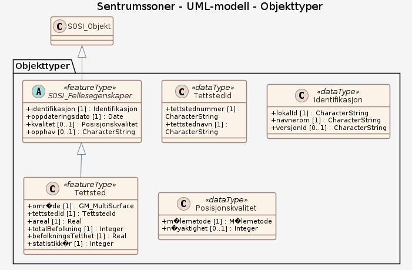

# Produktspesifikasjon: Sentrumssoner

*Inneholder avgrensning av og statistikk knyttet til sentrumssoner pr. 01.januar   Består av 3 lag:  Handels- og servicesoner, Sentrumsanalyseruter og Sentrumssoner.  Produseres årlig, kun siste eksisterende år tilgjengeliggjøres.  For info om eldre datasett kontakt gisressurssenter@ssb.no
1. Eit sentrum er eit område sett saman av ein eller fleire sentrumskjernar og ei sone på 100 meter i kring. 2. Ein sentrumskjerne er eit område med minst 4 ulike hovudnæringsgrupper med sentrumsfunksjonar. I tillegg til detaljvarehandel, må offentleg administrasjon eller helse- og sosialtenester eller kulturell verksemd, underhaldning eller annan tenesteyting vere representert. Avstanden mellom bedriftene skal ikkje vere meir enn 50 meter. Det må vere minst 50 tilsette i sentrumssona. For mer informasjon: <http://www.ssb.no/arealsentrum>.

Årsdatasett er nedlastbar både fra SSBs kartportal <https://kart.ssb.no>  > Se eget Tema "Sentrumssoner" eller gå til "Innholdskatalog" for oversikt over alle tilgjengelig datasett*

**Nøkkelord:** Arealbruk, Befolkning

**Emnekategorier:** Samfunn og kultur

**Geografisk utstrekning**:

- **Vest**: 2.0
- **Øst**: 33.0
- **Sør**: 57.0
- **Nord**: 72.0

**Tidsmessig utstrekning**:

- **Tidsperiode**:
  - **Fra**: 2022-03-29
  - **Til**: 2022-03-29

## Om spesifikasjonen

> **Denne versjonen av produktspesifikasjonen:**  
> **Opprettet dato:** 2022-03-29 
> **Endret dato:** 2022-03-29 
> **Språk:** nor 
> **Kontaktinformasjon:** Statistisk sentralbyrå, [erik.engelien@ssb.no](mailto:erik.engelien@ssb.no)

## Om produktet Sentrumssoner

> **Romlig representasjonstype:** Vektor 
> **Unik identifikator:** b7b6a84e-de26-4c26-a6fb-81140c517b5b 
> **Kontaktinformasjon:** Statistisk sentralbyrå, [erik.engelien@ssb.no](mailto:erik.engelien@ssb.no)
>
> **Romlig oppløsning:**
>
>
>
> **Begrensninger:**
>
> **Ressursbegrensninger**:
>
> - **Bruksbegrensninger**: Ingen begrensninger på bruk
>
> **Juridiske begrensninger**:
>
> - **Tilgangsbegrensninger**: Åpne data
> - **Bruksbegrensninger**: Lisens
> - **Lisens**: Norsk lisens for offentlige data (NLOD)
> - **Lisenslenke**: <http://data.norge.no/nlod/no/1.0>
>
> **Sikkerhetsbegrensninger**:
>
> - **Klassifisering**: Ugradert

### Formål

Overordnet planlegging

### Bruksområde

Dataene egner seg til framstilling av temakart, oversiktskart og til geografiske analyser. I tillegg til grunnlag for statistikk er avgrensningene egnet til overordnet planlegging.

## Omfang

### Hele datasettet

**Nivå**: dataset

**Nivåbeskrivelse**: Gjelder hele datasettet. Hvis omfang ikke er oppgitt under en overskrift, gjelder teksten for hele datasettet og alle leveranser

### UML-modell

**Nivå**: dataset

## Datainnhold og struktur

### Datamodell - UML-modell

➡️ [Se full datamodell for omfang "UML-modell" (diagram per pakke og objektkatalog)](uml-modell/objektkatalog.html)

## Datakvalitet

**Nivå**: dataset

**Kvalitetsmål**: Sosi applikasjonsskjema

- **Beskrivende resultat**: GML-filer er ikke vurdert i henhold til applikasjonsskjema

## Datafangst og produksjon

Sentrumssonene blir avgrensa ut frå verksemdregisteret hjå SSB. Avgrensinga er ein grov modellering av sentrum ved buffersoner.

## Vedlikehold

**Vedlikeholdsfrekvens**: Årlig

## Leveranse

| Tjeneste | Endepunkt | Type | Format | Leveranseenheter |
| --- | --- | --- | --- | --- |
| Egen nedlastningsside | [Lenke](https://kart.ssb.no/) | WWW:DOWNLOAD-1.0-http--download | Shape, GeoJSON, GML, KML, Parquet | landsfiler |
| Sentrumssoner WMS | [Lenke](https://kart.ssb.no/api/mapserver/v1/wms/sentrumssoner?service=WMS&version=1.3.0&request=GetCapabilities) | WMS-tjeneste | GML |  |
| GeoPackage: uml-modell | [Lenke](https://raw.githubusercontent.com/ToreFreddyB/produktspesifikasjon_ssb/main/produktspesifikasjon/sentrumssoner/uml-modell/uml-modell.gpkg) | Nedlasting | GPKG |  |

## Metadata

**Metadatastandard**: ISO19115

**Metadatastandardversjon**: 2003

**Metadatadato**: 2026-01-07

**språk**: nor

**Kontakt**:

- **Organisasjon**: Statistisk sentralbyrå
- **Kontaktperson**: Erik Engelien
- **Logo**: <https://register.geonorge.no/data/organizations/971526920_SSB_liten.png>
- **Epost**: erik.engelien@ssb.no
- **rolle**: pointOfContact

**Metadataidentifikator**:

- **Utsteder**: Geonorge
- **kode**: b7b6a84e-de26-4c26-a6fb-81140c517b5b
- **koderom**: <https://kartkatalog.geonorge.no/metadata/>
- **Metadatalenke**: <https://kartkatalog.geonorge.no/metadata/b7b6a84e-de26-4c26-a6fb-81140c517b5b>

## Tilleggsinformasjon

- **Produktark:** [https://register.geonorge.no/register/versjoner/produktark/statistisk-sentralbyra/sentrumssoner](https://register.geonorge.no/register/versjoner/produktark/statistisk-sentralbyra/sentrumssoner)
- **Produktside:** [https://www.ssb.no/natur-og-miljo/areal/statistikk/aktivitet-i-sentrumssoner](https://www.ssb.no/natur-og-miljo/areal/statistikk/aktivitet-i-sentrumssoner)
